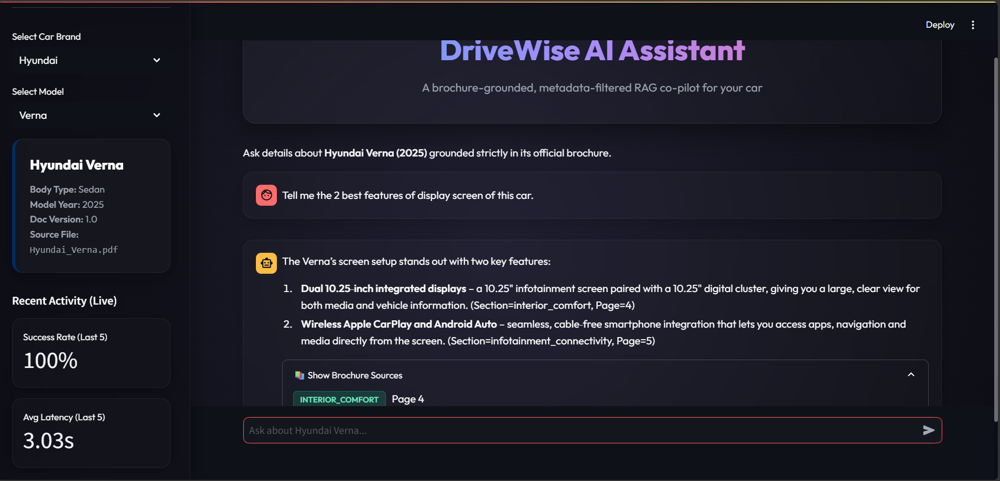
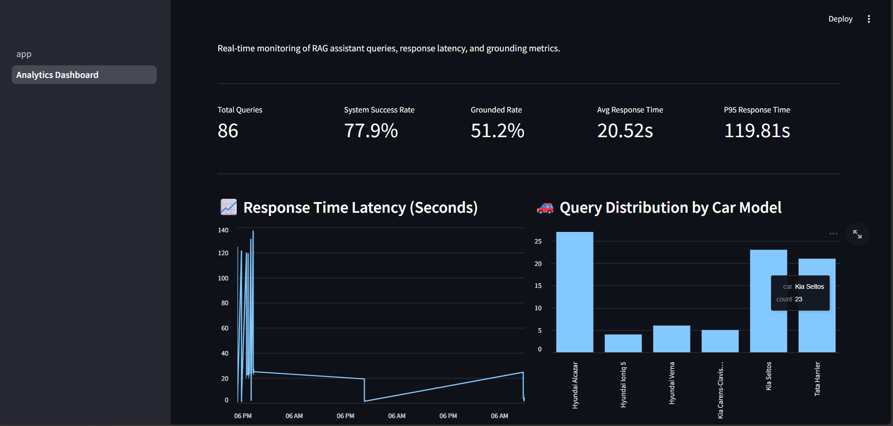

# DriveWise: Metadata-Aware, Brochure-Grounded RAG Assistant

DriveWise is an industry-grade, brochure-grounded Retrieval-Augmented Generation (RAG) assistant designed for automotive brochures. Users can select a specific car brand and model, then ask natural language questions. The system retrieves information **only** from the selected vehicle's official PDF brochure, provides a concise answer, and cites the exact brochure section and page number for verification.

---

### 📸 Interface Screenshots

#### Main Chat Assistant



#### Analytics & Telemetry Dashboard



---

## 📖 Table of Contents

1. [Project Goal](#1-project-goal)
2. [Technical Stack](#2-technical-stack)
3. [System Architecture](#3-system-architecture)
4. [Evaluation Results](#4-evaluation-results)
5. [File Structure](#5--file-structure)
6. [Setup and Execution Guide](#6-setup-and-execution-guide)

---

## 1. Project Goal

General chatbots tend to hallucinate or mix up details when asked about specific vehicle models. DriveWise addresses this by implementing:

- **Brochure-Grounded Constraints**: The assistant answers questions _only_ using the provided PDF brochure.
- **Strict Citation Rules**: Every answer must map back to its exact brochure section and page number.
- **Graceful Refutations**: If the context is insufficient or the question is out of scope (e.g. asking about resale value), the system clearly states that the information is not in the brochure instead of guessing.
- **Dynamic Configuration**: Adding a fourth car brochure later requires only dropping the PDF in `data/raw/` and adding one entry to the catalog config.

---

## 2. Technical Stack

- **Framework**: Python, LangChain (`langchain`, `langchain-core`, `langchain-community`, `langchain-text-splitters`)
- **PDF Extraction**: `PyMuPDF` (`fitz`) — chosen for clean spec-table and multi-column layout parsing.
- **Text Chunking**: `RecursiveCharacterTextSplitter`
- **Embeddings**: `BAAI/bge-small-en-v1.5` via `langchain-huggingface` (free, open-source, normalized).
- **Vector Database**: `Chroma` (`langchain-chroma`) persisted to disk, with native `$and` metadata filters.
- **Hybrid Retrieval**: In-memory `BM25Retriever` (sparse) + Chroma (dense) combined via `EnsembleRetriever` (0.5/0.5 weights).
- **Re-ranking**: `ContextualCompressionRetriever` with `CrossEncoderReranker` using `cross-encoder/ms-marco-MiniLM-L-6-v2` (`top_n=4`).
- **Generation & Grading**: Groq API using `llama-3.3-70b-versatile` with Pydantic structured output.
- **User Interface**: Multi-page `Streamlit` (Main Chat Application + Analytics Dashboard).
- **Evaluation**: `ragas` (`faithfulness`, `answer_correctness`, `context_precision` metrics).

---

## 3. System Architecture

### Phase 1: Ingestion (`ingestion/`)

1. **`extract.py`**: Extracts text from PDF brochures page-by-page, skipping blank pages and tracking 1-indexed page numbers.
2. **`chunker.py`**: Performs page-level classification using a keyword-scoring classifier against a section taxonomy:
   - `engine_performance`, `mileage_fuel_efficiency`, `safety`, `dimensions`, `interior_comfort`, `infotainment_connectivity`, `exterior_styling`, `variants_pricing`, `general_overview` (fallback).
     After classification, pages are split into chunks which inherit the page's section label, page number, and car metadata.
3. **`run_ingestion.py`**: Coordinates processing across the `BROCHURE_CATALOG` configuration and writes chunks to `data/chunks.jsonl`.

### Phase 2: Vector Store (`retrieval/`)

1. **`build_vectorstore.py`**: Loads the JSONL chunks, generates embeddings using `bge-small-en-v1.5`, and persists them in a structured collection in `data/chroma_db/`.

### Phase 3: Hybrid Retrieval & Re-ranking (`retrieval/`)

1. **`hybrid_retriever.py`**:
   - Scopes the document pool to the selected brand and model.
   - Builds a scoped `BM25Retriever`.
   - Initializes a metadata-filtered Chroma retriever using `$and` conditions.
   - Ensembles them (50/50 sparse/dense) and passes the results to a Cross-Encoder model to return the top 4 re-ranked chunks.

### Phase 4: Context Building & Generation (`generation/`)

1. **`context_builder.py`**: Performs word-overlap Jaccard similarity checks to filter out duplicate chunks, assembling a prompt context under a strict ~1500-token budget.
2. **`schema.py`**: Forces the LLM to output a Pydantic structure: `{"answer": str, "grounded": bool, "sources": [{"section": str, "page_number": int}]}`.
3. **`chain.py`**: Generates answers, handles greetings/refutations, and packages metadata.

### Phase 5: Telemetry & Monitoring (`logs/`)

1. **`logger.py`**: Logs query details (timestamps, latency, success status, grounded status, and source counts) to a JSONL query log.
2. **`analytics.py`**: Computes rolling metrics, query distributions, and failed query logs for the Streamlit dashboard.

---

## 4. Evaluation Results

The system was evaluated against a handwritten test set of **15 queries** containing ground-truth facts extracted directly from the car brochures.

- **Total Test Queries**: 15
- **Retrieval Section-Match Rate**: 66.67% _(Deterministic: Expected brochure section was successfully retrieved in the top chunks)_
- **Grounded Rate**: 60.00%
- **Average Pipeline Response Time**: 11.82 seconds
- **RAGAS Faithfulness**: 0.8438
- **RAGAS Answer Correctness**: 0.5508
- **RAGAS Context Precision**: 0.6190

---

## 5. 📁 File Structure

```
drivewise/
├── README.md                      # Setup and usage guide (this file)
├── requirements.txt               # Pinned Python package dependencies
├── .env                           # API keys and provider settings
├── config.py                      # Brochure configurations and taxonomies
├── app.py                         # Main Streamlit chat UI
├── data/
│   ├── raw/                       # Source brochure PDFs
│   ├── chunks.jsonl               # Generated document chunks
│   └── chroma_db/                 # Persisted Chroma DB files
├── ingestion/
│   ├── extract.py                 # PyMuPDF text parser
│   ├── chunker.py                 # Page classification & splitting
│   └── run_ingestion.py           # Ingestion coordinator
├── retrieval/
│   ├── build_vectorstore.py       # Chroma database builder
│   └── hybrid_retriever.py        # Scoped BM25 + Chroma + Cross-Encoder reranker
├── generation/
│   ├── schema.py                  # Pydantic schemas for structured output
│   ├── context_builder.py         # Jaccard deduplication & token-budget context builder
│   └── chain.py                   # Generation pipeline coordinator
├── eval/
│   ├── test_set.py                # Ground truth test cases
│   ├── run_evaluation.py          # RAGAS evaluation runner
│   └── eval_results.json          # Compiled evaluation results
├── logs/
│   ├── logger.py                  # Safe JSONL query logger
│   └── analytics.py               # Telemetry metric processor
└── pages/
    └── 1_Analytics_Dashboard.py   # Streamlit monitoring dashboard
```

---

## 6. Setup and Execution Guide

### 1. Clone/Navigate to the Directory

Open your Command Prompt or PowerShell and navigate to the project directory:

```cmd
cd E:\Projects\DriveWise_CEI\DriveWise>
```

### 2. Configure Environment Variables

Verify your `.env` file contains your active Groq API Key:

```env
LLM_PROVIDER=groq
GROQ_API_KEY=gsk_your_actual_key_here
```

### 3. Ingestion and Database Setup

Run the ingestion and vector database compilation:

```cmd
set PYTHONNOUSERSITE=1 && conda run -n base python ingestion/run_ingestion.py
set PYTHONNOUSERSITE=1 && conda run -n base python retrieval/build_vectorstore.py
```

### 4. Run Evaluation

Verify the RAG pipeline metrics:

```cmd
set PYTHONNOUSERSITE=1 && conda run -n base python eval/run_evaluation.py
```

### 5. Launch the Streamlit App

Start the Streamlit server:

```cmd
set PYTHONNOUSERSITE=1 && conda run -n base streamlit run app.py
```

_(If you are running in PowerShell, replace `set PYTHONNOUSERSITE=1` with `$env:PYTHONNOUSERSITE=1`)._
